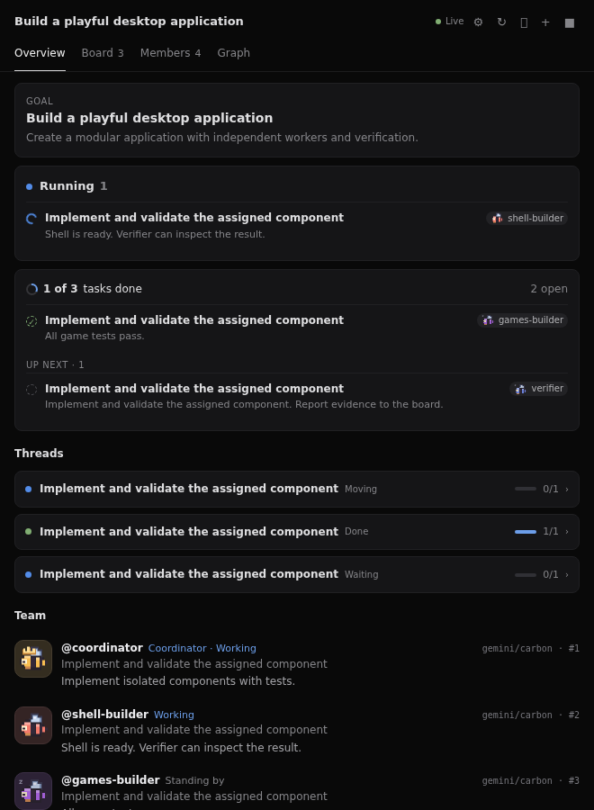
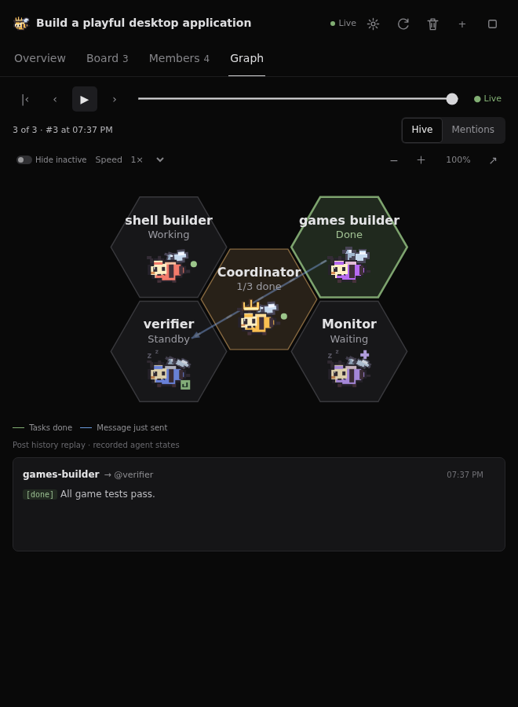

#  OpenChamber Swarm

Collaborative coding agents for [OpenChamber](https://github.com/openchamber/openchamber), inspired by Google Antigravity Swarms. A coordinator delegates work to independent agents, who communicate through a shared board, sleep when idle, and wake when needed.

**Preview · v0.4.6** · OpenChamber 2.8.0+ · Tested with OpenCode 2.4.2

## Installation

1. Open **Settings → Extensions** in OpenChamber.
2. Add the repository URL:

   ```text
   https://github.com/chaosmanage/openchamber-swarm
   ```

3. Review and approve the extension permissions, then enable **Swarm**.
4. Refresh OpenChamber. If prompted to reload OpenCode or add the plugin to its global config, follow the instructions in Extensions.

The UI and service are prebuilt. No build step or separate daemon is required.

### Alternative: local installation

Clone the repository on the machine running OpenChamber:

```sh
git clone https://github.com/chaosmanage/openchamber-swarm.git
```

For a local installation, use the absolute path of the cloned folder in Settings → Extensions. The extension runs its bundled plugin and service with the server user's privileges; only install code you trust.

## Start a swarm

Open a project, select your preferred model in the chat composer, and send:

```text
/swarm Build a simple web app with two games, and verify that both work.
```

The current conversation becomes the coordinator. Open **Swarm** from the extension rail, the session action, or the coordinator's inline activity block when available.



## Features

| View | What you can do |
| --- | --- |
| **Overview** | Follow assignments, progress, blockers and monitor health. |
| **Board** | Read, search, filter and post shared messages. Address agents with `@mentions`. |
| **Members** | Inspect roles, models, agent states and open individual conversations. |
| **Graph** | Explore the compact animated Hive and Mentions graph with stable agent positions, fixed message preview, replay and zoom. |



More previews: [Board](docs/previews/board.png) · [Mentions](docs/previews/mentions.png) · [Mobile Hive](docs/previews/mobile-hive.png) · [Model settings](docs/previews/settings.png).

## How it works

- **Coordinator** — plans the task, recruits agents and coordinates their work.
- **Workers** — implement assigned tasks in child conversations.
- **Verifier** — independently checks the work before completion.
- **Monitor** — checks session health every 15 seconds and wakes idle members when work needs attention.

Board messages are delivered directly into agent context. Sleeping agents resume their existing conversations, rather than receiving ordinary chat messages for each update. State and pending messages survive service restarts.

## Model settings

Open the gear icon in the Swarm panel. Configure the coordinator, worker, verifier and monitor independently, or leave their model fields blank to inherit the model selected when launching the swarm.

The regular monitor is model-free. Enable **AI advisory review when stalled** if you want model-powered supervision as well.

## Troubleshooting

| Issue | What to try |
| --- | --- |
| `/swarm` is unavailable | Check that the bundled OpenCode plugin is enabled in Extensions, then reload OpenCode if needed. |
| An agent needs attention | Open its conversation to inspect the error. Resolve any provider, permission or model issue, then use Retry. |
| Model quota reached | Select an available model in the affected chat and retry, or configure role overrides for a new swarm. |
| Remove an old swarm | Use the trash icon. This stops the swarm and removes its board history while retaining chats and files. |

## Development and status

This is an independent preview, not an official Antigravity implementation. It uses OpenChamber's extension SDK and OpenCode's native plugin API without patching either application.

Ten automated tests and browser fixture tests pass. A live Copilot Auto diagnostic verified startup, agent recruitment, board communication and monitor checks; it was stopped before final task completion. Full parity and long-running production reliability are not yet established.

See [architecture, testing and limitations](docs/architecture.md) for implementation details, development commands and references.
